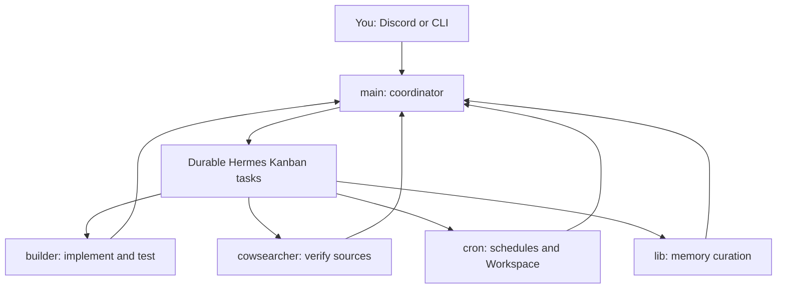

# Wesley's Hermes personal assistant

**This is the setup behind my assistant—not a new AI model or a copy of my accounts.**

It uses [Hermes Agent](https://github.com/NousResearch/hermes-agent), a configurable agent framework, with a primary assistant, four specialist profiles, skills, and optional custom integrations. I talk to `main` through Discord; it can research, write files/code, coordinate work, and use services I have authorized.

**Verified snapshot: 2026-10-19.** The primary profile is configured for **`gpt-6.1-sol` through `openai-codex`**. Model access depends on your own account; you can choose another available model. This repository does **not** provide model weights, a subscription, or credentials.

> **Start here, not with the old backup instructions.** This is now a sanitized, shareable setup with safer installation defaults. It is not a byte-for-byte restore of my running machine. Local core patches and private integrations mean cloning it does not reproduce every behavior. [Exactly what is included and what differs →](docs/REPRODUCIBILITY.md)

## The team

| Profile | Responsibility | Observed configured model | Provider |
| --- | --- | --- | --- |
| `main` | Primary assistant, coordination, recovery, final answers | `gpt-6.1-sol` | `openai-codex` |
| `builder` | Implementation, files, code, debugging and tests | `gpt-6.1-sol` | `openai-codex` |
| `cowsearcher` | Research and current-fact verification | `meituan/longcat-2.5-preview:free` | `nous` |
| `cron` | Schedules, reminders and authorized Workspace operations | `gpt-6.1-sol` | `openai-codex` |
| `lib` | Memory curation only: dedupe, reconcile, prune | `gpt-6.1-sol` | `openai-codex` |

These are **profile defaults**, not proof that every past conversation or scheduled job used those models. Fallback choices and per-job snapshots can differ. The separate `default` profile is not `main` and is not exported as the current assistant.



Profiles are separate assistant homes with their own prompts and settings. The coordinator handles small tasks itself, delegates real tasks through Hermes' board, reads the results, and handles recovery. Mentioning an agent name in Discord is not itself a worker launch. Role prompts describe intended behavior; they are not an OS security boundary.

**Memory: one source of truth.** The Obsidian vault plus its second-brain index holds durable knowledge. Main reads and writes routine memory directly; lib only curates. `MEMORY.md` stays compact, and finished tasks go to a separate completion log.

## What you get

- Five **adapted, portable profile templates**, retaining the observed model choices and core roles.
- Sanitized **live prompt and allowlisted settings references**, clearly separated from what the installer uses.
- Profile-scoped skill snapshots: coding, GitHub, research, documents, Google Workspace, Canvas, memory and more. Skills are opt-in when installing; optional tools still need their own dependencies and accounts.
- Optional source for the permissions hook, briefing curation, second-brain retrieval/package, Workspace request helper and host-automation scripts. These are **reference extensions, not automatically installed or enabled**.
- An exact payload hash manifest, a non-clobbering installer, tests and GitHub validation workflow.
- A machine-readable [inventory](inventory.json) showing observed versus bundled skills, enabled plugin names and schedule counts, without private job contents.

No tokens, OAuth credentials, private notes, conversation stores, live job prompts, personal finance records, Discord routing state, account identifiers, or caches are intentionally included in the new snapshot. **That statement does not certify old Git history**—see [Security](SECURITY.md).

## Try it on your own machine

### 1. Install Hermes

Follow the [official installation guide](https://hermes-agent.nousresearch.com/docs/getting-started/installation). Its current CLI source-install commands are:

**Windows native — PowerShell, as your normal user:**

```powershell
iex (irm https://hermes-agent.nousresearch.com/install.ps1)
```

**Linux, Apple Silicon macOS, or WSL2 — your POSIX terminal:**

```bash
curl -fsSL https://hermes-agent.nousresearch.com/install.sh | bash
```

The official site also offers desktop packages. Read installer scripts before executing downloaded code. Open a new terminal after installation. Native Windows data normally lives under **`%LOCALAPPDATA%\hermes`**, not `%APPDATA%`; Linux/macOS/WSL normally use **`~/.hermes`**. WSL and native Windows are distinct installations. [Native Windows guide](https://hermes-agent.nousresearch.com/docs/user-guide/windows-native).

### 2. Clone and validate this setup

You need Git and a Python interpreter for the small standard-library-only bundle tool. On systems where the interpreter is named `python3`, use it instead of `python` below. You **do not need a GitHub account or the `gh` CLI** just to clone a public repository.

```bash
git clone https://github.com/iliekhotdogs/wesley-hermes.git
cd wesley-hermes
python tools/bundle.py validate
python -m unittest discover -s tests -v
```

Inspect the prompts, configuration and optional skill scripts before installing them. `config.yaml` and `profile.yaml` in the templates are JSON-formatted YAML, so validation and installation require no extra Python packages.

### 3. Install fresh profiles — never over an existing setup

**Native Windows — PowerShell:**

```powershell
python tools/bundle.py install --target "$env:LOCALAPPDATA\hermes" --profiles main builder cowsearcher cron lib
```

**Linux/macOS/WSL:**

```bash
python tools/bundle.py install --target "$HOME/.hermes" --profiles main builder cowsearcher cron lib
```

`--target` is the **Hermes data root**, not `profiles/main` and not an already-active profile's `HERMES_HOME`. If you deliberately installed Hermes with a custom data root, use that root rather than these defaults. The installer refuses to overwrite **any selected existing profile**; it does not merge, delete, back up or reset your current setup. Use a separate test installation or review individual files manually if names collide.

To opt in to the included skill snapshots, add `--with-skills` to the same command **on the first install**. Without that flag, only `config.yaml`, `SOUL.md`, and profile description metadata are copied. No aliases, credentials, plugins, schedules, gateway services or external resources are created. Do not rerun with an overwrite workaround just to add skills.

### 4. Connect your own model account

```bash
hermes profile list
hermes -p main setup
hermes -p main model
hermes -p main chat
```

Choose a provider/model your own account supports. Configured model names do not grant account access. Run the corresponding setup/model commands for the other profiles you intend to use; follow Hermes' supported credential-sharing behavior rather than copying OAuth files. Do not manually create or overwrite `auth.json`.

For optional services, authorize **your own** Google account, Canvas instance, research/tool providers and vault as needed. See the [integration checklist](docs/INTEGRATIONS.md). Your friends cannot and should not connect through my accounts.

### 5. Optional: talk through Discord

Follow the [official Discord guide](https://hermes-agent.nousresearch.com/docs/user-guide/messaging/discord): create your own application and bot, configure the required intents, invite it to your server with appropriate permissions, and allowlist only trusted people.

```bash
hermes -p main gateway setup
hermes -p main gateway run
```

Configure **your own** token and destinations through setup; never reuse my old IDs or gateway state. The foreground command keeps running. Use the official OS-specific service guide if you want automatic startup—this bundle does not create a service. Check gateway status, send a harmless message and confirm delivery before relying on it. Confirm your installed version's Kanban dispatcher behavior before relying on specialist handoffs; `hermes kanban dispatch --help` describes its one-pass dispatcher and `--dry-run` inspection mode. No existing board or tasks are imported.

## Safety differences from my machine

My observed deployment uses `approvals.mode: off` with custom role restrictions. **The installable templates deliberately use `manual` for dangerous-command approval and `deny` for dangerous unattended/cron/one-shot commands**, retain destructive-session confirmations, and start with an empty command allowlist. These are approval settings, not a filesystem/network sandbox or a guarantee that every file write prompts. Prefer a disposable environment or suitably configured sandbox when experimenting.

The prompts do not grant my administrative or Google API authority to you. Optional plugins are disabled and not copied by the installer. No personal reminders are imported: the snapshot observed **4 jobs in `main` (3 enabled) and 21 in `cron` (12 enabled)**, but the only shipped automation examples are inert descriptions. Schedule new jobs yourself with your own times, timezone, scope and destinations.

## Details, verification and updating

- [Reproducibility and exact differences](docs/REPRODUCIBILITY.md)
- [Optional integrations and custom code](docs/INTEGRATIONS.md)
- [Discord channel layout](docs/DISCORD.md)
- [Cron job inventory](docs/CRON-INVENTORY.md)
- [Security and old-history caveat](SECURITY.md)
- [Snapshot inventory](inventory.json)
- [Validation evidence](docs/VERIFICATION.md)
- [Maintenance procedure](docs/MAINTAINING.md)

Do not run `git add -A` against a raw Hermes home and assume `.gitignore` makes it safe. Export explicit allowlisted assets, review the staged tree, regenerate hashes, scan for secrets/private state and test against an isolated home before publishing.

This repository's validation verifies the shipped files and installer behavior; it does not prove every optional integration, provider login, model request, scheduler, local patch or Discord service works on a fresh machine. Those require the reader's own authorization and environment-specific checks.

## Attribution

Hermes Agent is developed by [Nous Research and contributors](https://github.com/NousResearch/hermes-agent). Bundled skills and extension files retain their existing authorship/license metadata; inclusion here does not relicense third-party content. This repository is a personal configuration and source-reference collection, not an official Hermes distribution or a model release.
